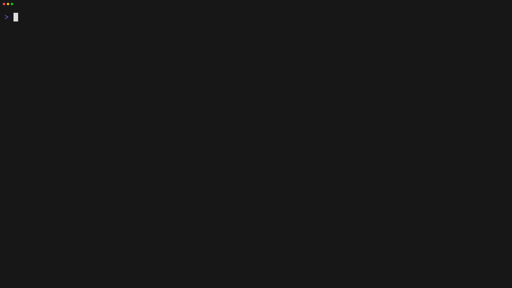

# Cradle 🧺

Cradle helps you manage your local projects from the terminal.

[](https://go.dev/)
[](LICENSE)

**Quickly jump from project to project ⚡️**

<p align="center">
  
</p>

## Why Cradle?

- Keep all your projects in one place
- Jump into any project instantly
- Scaffold new projects from templates
- Clean up temporary experiments
- Keep your workspace healthy with `doctor`

## Install

```sh
go install github.com/gurleensethi/cradle@latest
```

## Shell setup (one-time)

Add the helper so Cradle can switch directories for you:

```sh
crdl() {
  out=$(CRADLE_CMDOUT=1 cradle "$@" 3>&1 1>&2 2>&3)
  if [[ $out == eval* ]]; then
    eval "${out#eval}"
  else
    printf '%s' "$out"
  fi
}
```

Then use `crdl` instead of `cradle`.

## Quick start

```sh
crdl create my-app --template go
crdl list
crdl open my-app
```

## Commands

| Command | Description |
|---|---|
| `list` | List all managed projects |
| `create` | Create a new project |
| `add` | Register an existing project |
| `remove` | Remove a project from Cradle |
| `open` | Open a project |
| `cleanup` | Remove temporary projects |
| `doctor` | Check (and fix) workspace health |
| `templates` | List available templates |

## Templates

```sh
crdl templates list
crdl create my-api --template go-http
```

Available: `go`, `go-http`, `go-postgres-sqlc`, `go-postgres-sqlc-taskfile`, `go-postgres-sqlc-mise`.

## Configuration

- `CRADLE_HOME` — where Cradle stores data (default `~/cradle`)
- `CRADLE_CMDOUT` — enable directory switching output

## Contributing

Issues and pull requests are welcome. See [CONTRIBUTING.md](CONTRIBUTING.md).

## License

MIT
